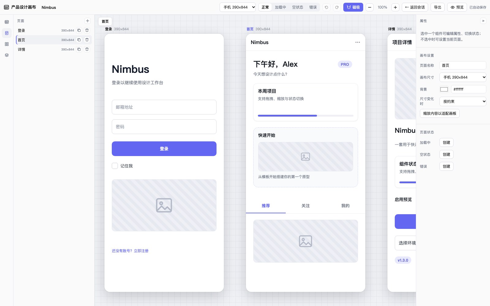
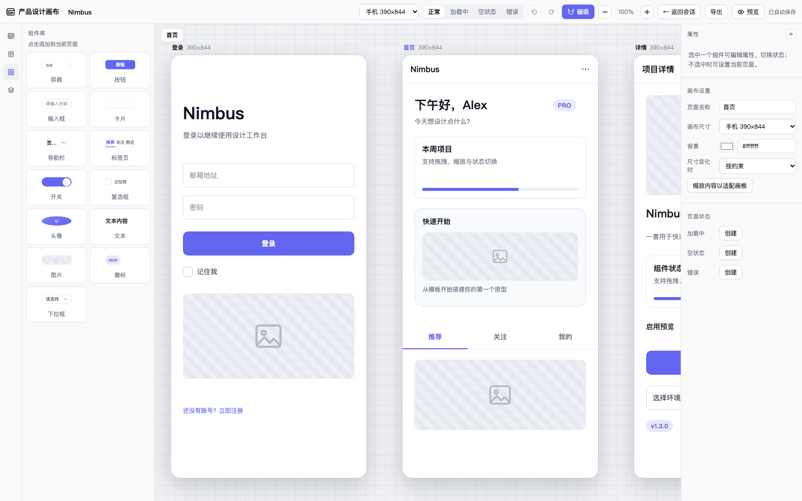
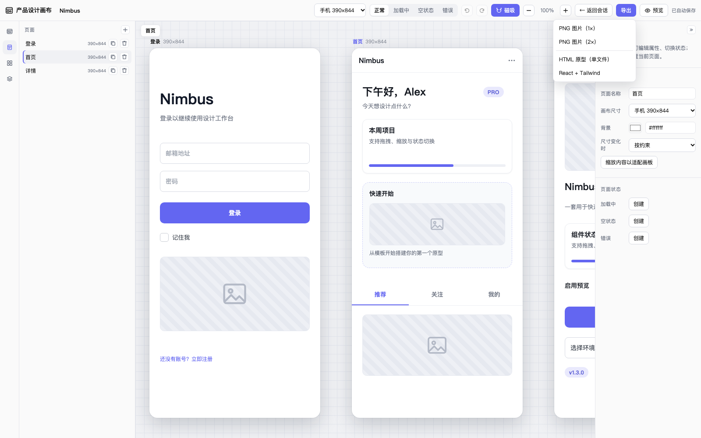
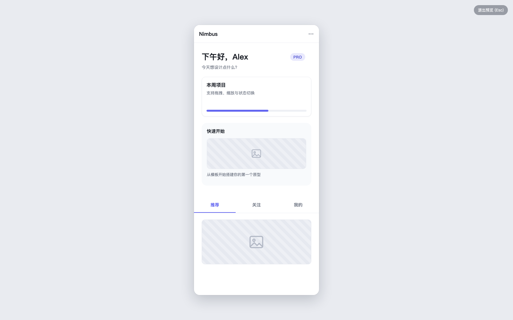

# dsh-product-design

会话标签页里的「简化版 Figma」产品设计画布。用于产品设计需求沟通：在画布上直接搭原型，组件可交互、可切换状态，加载 / 空 / 错误是可直接编辑的变体页。

> DSH 插件（DeepSeek Harness）。客户端半由 `src/client` 构建为单文件模块，通过 `window.__ModuleLoader__` 挂载会话视图、全屏画布与空会话入口。

## 安装

> 目前只通过 GitHub 分发，**未发布 npm**。`package.json` 保留 `private: true` 是故意的，避免误发布；GitHub 安装使用仓库里已提交的构建产物，不需要在本地构建，也不需要批准依赖构建脚本。

```bash
# Desktop
dsh plugin --profile desktop add github:KYCOMING/dsh-product-design

# Web
dsh plugin --profile web add github:KYCOMING/dsh-product-design
```

没有 `dsh` 命令时：打开 **插件 → 添加插件**，输入 `github:KYCOMING/dsh-product-design`。

安装后在「插件」页确认 `dsh-product-design` 已启用，然后重启 DSH（Host 半不会热加载）。打开一个已有消息的会话，顶部标签栏会出现「产品设计」，点击即可在该会话里编辑设计稿；也可以在画布内点「全屏」进入独立画布。

卸载：

```bash
dsh plugin --profile desktop remove dsh-product-design
```

### 兼容性

| DSH 版本 | 状态 |
| --- | --- |
| 0.2.2-rc.1 | ✅ 实测 |
| 0.2.0-rc.1 – 0.2.x | ⚠️ `engines.dsh` 允许，未逐一实测 |
| < 0.2.0 / >= 0.3.0 | ❌ 未声明支持 |

### 权限与数据

- 在 Host 进程内注册同源 HTTP 路由 `/dsh-product-design/api`，提供文档读写与 SSE 变更推送。
- 设计稿写入 `<DSH_HOME>/storages/dsh-product-design/docs/<docId>.json`，会话只记录当前打开的稿子（`sessions/<sessionId>/active.json`）；浏览器端另用 `localStorage`（`doc:v3:<sessionId>`）做缓存/离线兜底。
- 注册两个 agent 工具（`product_design_get_document` / `product_design_apply`）、一段系统提示和 `/design` 命令。
- 不发起外部网络请求，不收集遥测。

## 截图

> 示例设计稿「Nimbus」：登录、首页、详情三个画板。

### 编辑器：多画板、页面树与属性面板



### 组件库：13 类组件，点击添加到当前页



### 导出：PNG / 单文件 HTML / React + Tailwind



### 纯净预览：隐藏编辑器 UI，只保留产品画板



## 功能

- **多画板并排**：所有页面横向排在可平移 / 缩放的画布上，每页独立尺寸（手机 390×844 / 平板 768×1024 / 桌面 1280×800）、背景与组件。
- **组件库（13 种）**：容器、按钮、输入框、卡片、导航栏、标签页、开关、复选框、头像、文本、图片、徽标、下拉框；点击添加到当前页。
- **容器与编组**：容器可嵌套任意组件并裁剪超出内容；拖入 / 拖出容器自动改变层级。多选后可 `⌘G` 编组、`⇧⌘G` 取消编组，容器/编组随子元素整体移动。
- **多选与对齐**：`Shift + 点击` 多选、画板空白处拖拽框选；属性面板支持左/中/右、上/中/下对齐与水平/垂直分布。
- **磁吸对齐**：拖动 / 缩放时自动吸附画板边缘、画板中心线、其他元素边缘与中心，并显示洋红参考线；顶部「磁吸」开关可关闭。
- **画布编辑**：组件可拖拽移动、8 向手柄缩放、点选；支持复制、置顶/置底/上移/下移、删除；悬停显示轮廓。
- **就地编辑文本**：双击文本类组件直接改字，`Enter` 提交、`Shift+Enter` 换行、`Esc` 取消，字号/字重/颜色/对齐实时生效。
- **图层树**：拖拽排序、拖入容器、显隐、锁定、双击重命名、按名称搜索；容器子元素按层级缩进。
- **剪贴板与右键菜单**：`⌘C` / `⌘X` / `⌘V`（保留绝对位置、可跨页、可粘贴进选中容器）；右键菜单覆盖副本、层级、编组、显隐、锁定、删除。
- **面包屑与多选**：画布左上角显示 `页面 › 容器 › 元素` 可逐级点选；多选后可批量改颜色/字号/圆角/不透明度，或对齐、分布、编组。
- **约束（Constraints）**：每个元素可设置水平/垂直约束——左/右固定、左右拉伸、居中、按比例；画板或容器尺寸变化时按约束重排。默认 `left/top`，导航栏、标签页、卡片、图片、输入框、容器默认左右拉伸。右侧「画布设置」可把整页行为切为「按约束 / 整体缩放 / 保持不变」。
- **Auto Layout**：容器与编组可开启堆叠布局（横向/纵向 + 间距 + 四向内边距 + 交叉轴对齐 + 主轴分布）；开启后子元素坐标由布局接管，拖动子元素改变的是顺序而不是位置。
- **组件状态**：每个组件有独立状态集（如按钮 默认/悬停/按下/禁用，输入框 默认/聚焦/已填写/错误/禁用…），在右侧属性面板切换预览。
- **预览模式**：一键进入「只看产品」的干净视图——隐藏工具栏与左右侧栏、只显示当前画板、不显示网格与页面标签；组件真实响应悬停 / 按下 / 点击，开关、复选框、标签页、下拉可交互。`Esc` 或右上角「退出预览」返回编辑器。
- **原型交互**：给任意元素配置 `点击 → 跳转页面 / 返回 / 打开为弹层`，预览里可以真的走通一条流程（带返回栈，`Esc` 逐层退出）。
- **导出**：工具栏「导出」支持三种产物——当前页 PNG（1× / 2×）、单文件可交互 HTML 原型、React + Tailwind 组件文件。全部在浏览器内生成，不上传任何数据。
- **页面状态变体**：顶部「正常 / 加载中 / 空状态 / 错误」切换的是真实变体页——每个状态有自己的元素树，可以像普通页面一样增删改；预览里也能切换状态，导出 HTML / React 时带上状态切换条。AI 用 `add_page_state` 生成变体。
- **设计稿库**：左侧「设计稿」列出 Host 上的所有稿子，可新建、重命名、复制、删除、导出 / 导入 JSON；会话只绑定其中一份，换会话不会丢稿。
- **图片**：「图片」组件支持 URL 或本地文件（2MB 内转 data URL）、三种填充方式（cover / contain / fill），编辑器与三种导出都渲染真实图片。
- **空会话入口**：还没有消息的会话看不到顶部标签，但输入框旁的「打开产品设计」可以直接进入画布。
- **网格 + 缩放**：画布小方格网格随缩放变化；`Ctrl/⌘ + 滚轮` 缩放，普通滚轮滚动。
- **编辑体验**：撤销 / 重做（含 AI 改动）、键盘快捷键、空格 / 中键拖拽平移画布；左右侧栏均可拖拽调节宽度，右侧属性栏还可一键收起为窄条，避免遮挡画布。
- **对话内产品预览（Visualize 风格）**：AI 调用 `product_design_apply` 后，聊天回合末尾会出现当前页面的产品缩略卡片，可一键「打开画布」；无需先手动打开画布。
- **会话标签页**：产品设计是会话顶部的一个视图标签（与 Chat 并列），不再占用侧边栏；画布内可一键「全屏」，全屏模式可「返回会话」。
- **多会话与设计稿库**：每个会话绑定设计稿库中的一份稿子；切换会话时画布自动切换，互不覆盖；也可以在同一会话里切换不同稿子。
- **自动保存**：设计稿持久化到 Host（按会话分目录）和 `localStorage`（`doc:v3:<sessionId>`）。

## 导出

工具栏「导出」提供三种产物，全部在浏览器内生成，不上传数据：

| 格式 | 内容 |
| --- | --- |
| PNG（1× / 2×） | 当前页光栅图；模型渲染 → SVG `foreignObject` → canvas，无第三方依赖 |
| HTML 原型 | 单文件，内嵌全部页面与运行时：页面跳转、返回、弹层，开关/复选框/标签页/下拉可交互，双击即可打开 |
| React + Tailwind | 单文件 `Prototype.jsx`：每页一个组件，自由布局用绝对定位、Auto Layout 用 flex，按钮/输入框为语义标签，带 `useState` 页面路由 |

导出使用独立的「干净」渲染器（`src/client/export/render.js`），不会把编辑器辅助线、图层标签、选中框带进产物。

## 快捷键

| 快捷键                        | 作用                                |
| ----------------------------- | ----------------------------------- |
| `⌘Z` / `Ctrl+Z`               | 撤销                                |
| `⇧⌘Z` / `Ctrl+Shift+Z`、`⌘Y`  | 重做                                |
| `Delete` / `Backspace`        | 删除选中组件                        |
| `← → ↑ ↓`                     | 微移 1px（`Shift` + 方向键 = 10px） |
| `⌘D` / `Ctrl+D`               | 创建副本                            |
| `⌘C` / `⌘X` / `⌘V`            | 复制 / 剪切 / 粘贴（可跨页）         |
| `⌘]` / `⌘[`                   | 上移一层 / 下移一层                  |
| `⇧⌘]` / `⇧⌘[`                 | 置于顶层 / 置于底层                  |
| `⌘G` / `Ctrl+G`               | 编组选中组件                        |
| `⇧⌘G` / `Ctrl+Shift+G`        | 取消编组                            |
| `Shift + 点击`                | 多选 / 取消多选                     |
| `Esc`                         | 取消选中 / 退出预览                 |
| `Space` + 拖拽 / 鼠标中键拖拽 | 平移画布                            |

## 命令

| 命令 | 作用 |
| --- | --- |
| `/design <需求>` | 提交一条产品设计需求，作为普通用户消息交给 AI，由 AI 调用画布工具生成/修改设计 |

`/design` 实现：Host 半通过 `ctx.commands.register({ name: 'design', input: { hint: '<需求>' }, ... })` 注册；handler 将 `rawInput` 包装成普通用户消息并通过 `agent.followup()` 提交，因此 AI 会正常走产品设计工具链，而不是由命令直接改文档。

## 架构

双半插件：`src/` 是源码，根目录 `client.js` / `index.js` 是 esbuild 产出的**可加载单文件**（DSH 客户端只接受单文件模块，git 安装也不会在本地构建）。这两个文件文件头带 `AUTO-GENERATED` 横幅，**不要手改**；改 `src/` 后跑 `pnpm run build`。

```text
dsh-product-design/
├─ src/
│  ├─ client/                 # 浏览器半
│  │  ├─ index.js             # 入口：注册会话视图标签 / 全屏面板 / locale / 对话卡片
│  │  ├─ panel.js             # 组合根：只负责把 hooks 接到展示组件上（~450 行）
│  │  ├─ domain/              # 纯逻辑：无 React、无 DOM，可单测
│  │  │  ├─ tree.js           #   元素树不可变操作（增删改、复制、重挂载）
│  │  │  └─ document.js       #   文档变换（页面/元素/粘贴/对齐/编组/缩放）
│  │  ├─ editor/              # 行为层：React hooks，一个关注点一个文件
│  │  │  ├─ useDocument.js    #   文档状态 + 撤销历史 + Host 同步（SSE/POST）+ 切稿
│  │  │  ├─ useSelection.js   #   选区派生、批量属性、微移
│  │  │  ├─ useEditorActions.js # 页面/元素/排列命令（调用 domain）
│  │  │  ├─ useGestures.js    #   拖拽 / 缩放 / 框选 / 平移 / 磁吸 / 堆叠重排
│  │  │  ├─ usePreview.js     #   预览栈、弹层、状态切换、交互态
│  │  │  ├─ useClipboard.js   #   内部剪贴板
│  │  │  ├─ useTextEditing.js #   就地编辑
│  │  │  ├─ useKeyboard.js    #   全局快捷键映射
│  │  │  ├─ useUiPrefs.js     #   zoom / 磁吸 / 面板宽度 / 尺寸策略
│  │  │  ├─ useExport.js      #   PNG / HTML / React 导出命令
│  │  │  └─ contextMenuItems.js # 右键菜单命令表
│  │  ├─ export/              # 导出：模型 → PNG / HTML / React+Tailwind
│  │  │  ├─ render.js         #   干净 HTML 渲染（无编辑器辅助线，HTML/PNG 共用）
│  │  │  ├─ html.js           #   单文件交互原型 + 运行时
│  │  │  ├─ png.js            #   SVG foreignObject → canvas
│  │  │  ├─ react.js          #   JSX + Tailwind 生成器
│  │  │  └─ download.js       #   下载 / 文件名
│  │  ├─ ui/                  # 展示层：纯渲染 + 回调
│  │  │  ├─ toolbar.js
│  │  │  ├─ left.js           #   活动栏 + 页面/组件库/图层
│  │  │  ├─ canvas.js         #   多画板画布 + 就地编辑器 + 弹层
│  │  │  ├─ inspector.js      #   右侧属性面板
│  │  │  ├─ contextmenu.js
│  │  │  └─ exportmenu.js
│  │  ├─ react.js  constants.js  i18n.js  color.js  icons.js  styles.js
│  │  ├─ model.js             # 文档归一化 / localStorage / Host API 调用
│  │  ├─ docs.js              # 设计稿库客户端（列表 / 新建 / 重命名 / 复制 / 导入导出）
│  │  ├─ widgets.js           # 组件渲染
│  │  ├─ ui/heroEntry.js      # 空会话的「打开产品设计」入口
│  │  ├─ cards.js             # 对话内产品预览卡片
│  │  └─ session.js           # 跟随当前会话
│  ├─ shared/                 # 浏览器 / Host 共用纯逻辑
│  │  ├─ elements.js          #   元素树遍历、包围盒、深拷贝、缩放
│  │  ├─ layout.js            #   约束求解 + Auto Layout 重排（结构共享）
│  │  └─ snapping.js          #   磁吸几何
│  └─ host/
│     ├─ index.js             # 装配：注册 HTTP / tools / command / prompt
│     ├─ paths.js             # 文件系统布局
│     ├─ store.js             # 设计稿库 + 会话绑定 + revision + 订阅
│     ├─ http.js              # 同源 API 路由
│     ├─ tools.js             # agent 工具
│     ├─ preview.js           # 对话卡片描述
│     ├─ prompt.js            # 模型提示
│     ├─ command.js           # /design 命令
│     └─ model.js             # 文档 reducer（纯函数）
├─ scripts/build.mjs          # esbuild：src → client.js + index.js
├─ client.js   index.js       # 构建产物（提交入库，loader 直接读；勿手改）
├─ cordis.patch.yml
├─ locale/{zh,en}.json
├─ icon.svg
├─ test/                      # vitest + jsdom / node 回归测试
└─ package.json
```

- `client.js`：esbuild `format=cjs` 打包后，用 `window.__ModuleLoader__.load({ id, factory })` 包装；`react` 保持 external，由 loader 的 `require('react')` 注入。
- `index.js`：esbuild 打 Node ESM（内联 `src/host/model.js`）。
- 分层约定：
  - **domain/**：纯函数，输入输出都是文档对象，不依赖 React / DOM / 存储。改文档语义只改这里。
  - **editor/**：React hooks，持有状态与副作用（历史、Host 同步、手势、预览），调用 domain。
  - **ui/**：只接收 props 并渲染，不读文档、不发请求。
  - **panel.js**：组合根，只做 hook 装配和布局。
- `model.js` 负责归一化与持久化；`widgets.js` 纯渲染；`i18n/constants/color` 无副作用；`host/model.js` 是与 UI 无关的纯 reducer。
- 新增一个编辑命令的路径：`domain/document.js` 写纯变换 → `editor/useEditorActions.js` 暴露命令 → `ui/*` 调用。

## AI 可编程画布（宿主权威）

设计稿的所有权在 **Host**，浏览器只是视图，因此模型可以通过工具直接读写画布：

- **数据**：`<DSH_HOME>/storages/dsh-product-design/docs/<docId>.json`（默认 `~/.dsh/...`），每份稿子含 `revision` 与 `doc`；`sessions/<sessionId>/active.json` 记录该会话当前打开哪份稿子。
- **HTTP 路由**（同源，前缀 `/dsh-product-design/api`）：
  - `GET /doc` → `{ docId, revision, doc }`
  - `POST /doc` → `{ baseRevision, docId, doc }`（乐观并发，版本或 docId 不匹配返回 409 + 当前文档）
  - `POST /session/doc` → `{ sessionId, docId }`（切换会话当前稿）
  - `GET /docs` / `POST /docs` / `POST /docs/rename|duplicate|delete|import` / `GET /docs/export` → 设计稿库
  - `POST /apply` → `{ operations: [...] }`（服务端 reducer）
  - `GET /events` → SSE，每次变更推送 `{ revision, docId }`
- **Agent 工具**（`ctx.get('tools').register`）：
  - `product_design_get_document`：读取当前文档（页面 / 元素 / 状态 / 属性）。
  - `product_design_apply`：按顺序应用操作，返回生成的 page/element id 与新 revision。支持 `add_page` / `duplicate_page` / `delete_page` / `rename_page` / `set_active_page` / `set_page_frame` / `add_page_state` / `delete_page_state` / `clear_page` / `add_element` / `update_element` / `delete_element` / `move_element` / `reorder_element` / `group_elements` / `ungroup_elements` / `set_document_name`；页面可用 `pageId`、`"@last"` 或 `pageIndex` 定位。元素支持 `name / hidden / locked / opacity / interactions`。
- **模型提示段**：通过 `ctx.systemPrompt.section` 注册说明，告诉模型画布与工具、坐标系与组件/状态清单，以及“先 get 再单次 apply 批量搭建”。
- **同步**：客户端 GET + SSE 拉取 Host 变更；本地编辑 400ms debounce 回写；冲突以 409 让客户端采纳服务端版本。Host 不可用时自动退回 localStorage 单机模式。
- **安全**：路由复用 Host 的 `connection.requestRejection` 同源护栏（若有）；默认仅本机回环绑定。

## 开发

```bash
pnpm install
pnpm run build      # src/ → client.js + index.js（改完 src 必须重新构建）
pnpm run test       # vitest（pretest 会自动 build）
pnpm run lint       # biome 检查 src / scripts / test
pnpm run check      # build + syntax + lint + test 一次跑完
```

> `client.js`、`index.js` 是构建产物，**不要手改**；改 `src/**` 后 `pnpm run build`，刷新页面即可。改了 Host 半（`index.js`）需要重启 Harness 让宿主重新加载。

开发时可以把本目录链接进 profile（`dsh plugin --profile desktop add /absolute/path/to/dsh-product-design`）；公开安装方式见上文「安装」。

## 数据存储

- **Host 权威**：`<DSH_HOME>/storages/dsh-product-design/docs/<docId>.json`（`{ revision, doc }`），设计稿库供 AI 工具读写；`sessions/<sessionId>/active.json` 只记录会话当前稿。
- `dsh-product-design:doc:v3:<sessionId>`：浏览器端 **按会话缓存/离线兜底**（Host 不可达时使用；首次连接时若 Host 为空则作为种子上报）。
- `dsh-product-design:ui:v1`：界面偏好（左右侧栏宽度、当前分区、磁吸开关）。
- 文档格式为 v3；开发阶段不保留旧格式迁移，旧稿不会被读取。

## 版本与发布

- 语义化版本，变更记录见 [CHANGELOG.md](CHANGELOG.md)。
- 当前只通过 GitHub 分发，不发布 npm；`private: true` 是故意保留的。
- 发布流程：更新 `CHANGELOG.md` 与 `package.json` → `pnpm run build` → 提交 → 打 annotated tag `vX.Y.Z` → `git push origin vX.Y.Z` → 创建 GitHub Release。
- 兼容性通过 `engines.dsh` 约束；`peerDependencies.react` 由 DSH 客户端注入。

## 许可

MIT，见 [LICENSE](LICENSE)。
